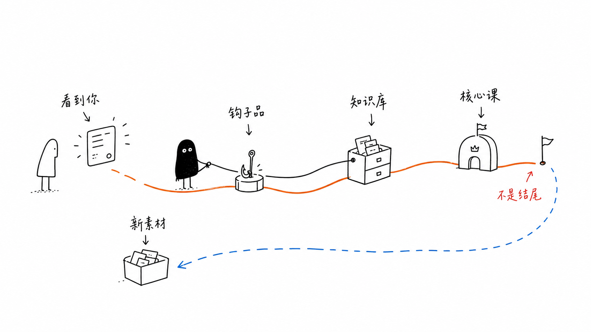

# Network & IT learning notes

Concise explanations with a visual overview, a Mermaid diagram, and one practical example.

- [Writing guidance](AGENTS.md)
- [Repo-local illustration skill](skills/it-overview-illustrations/SKILL.md)
- [Overview illustration style](docs/illustration-style.md)
- [Concept note template](templates/concept-note.md)

## Agent workflow

`AGENTS.md` routes concept-note authoring and illustration changes to `it-overview-illustrations`. The skill reads the English style guide and the relevant pinned upstream references, then delivers a concise note with a saved overview image and Mermaid diagram. It can be followed directly from its source path even before automatic discovery is configured.

To enable automatic Codex discovery, run these commands from the repository root once:

```bash
mkdir -p .agents/skills
ln -s ../../skills/it-overview-illustrations .agents/skills/it-overview-illustrations
```

The relative symlink keeps one maintained copy of the skill and works when the repository is cloned. Commit both `skills/it-overview-illustrations/SKILL.md` and the symlink. If the skill does not appear in Codex after linking it, restart the session. In Codex CLI or the IDE extension, you can invoke it explicitly with `$it-overview-illustrations`.

Example request: “Create a concise DNS concept note with an overview illustration and a Mermaid lookup sequence.”

## Illustration reference

We use [Ian Xiaohei Illustrations](https://github.com/helloianneo/ian-xiaohei-illustrations), by Ian, as inspiration: one idea per image, sparse hand-drawn lines, and minimal labels. New topic illustrations use English labels and explain the concept being taught.



*Upstream style sample, not a networking diagram. Three original sample images and the illustration guidance are available in the [local reference package](third-party/ian-xiaohei-illustrations/PROVENANCE.md), with the MIT license and attribution preserved.*
