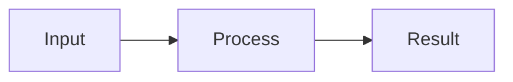

# {{Concept}}

{{Define the concept in 1-2 sentences and explain why it matters.}}

<!-- Generate and save the overview before inserting its relative Markdown image link here. Use descriptive alt text. Do not publish this template's placeholders. -->

{{One-sentence overview caption; state any important limit of the analogy.}}

## Key points

- {{What it does.}}
- {{How it works.}}
- {{One distinction or common misunderstanding.}}

## How it works

<!-- Replace this illustrative Mermaid structure with the topic's actual relationships or sequence. -->

{{One sentence explaining the flow.}}

## Example

{{One concrete scenario or short command, with the expected result.}}

## Sources

<!-- Include authoritative links supporting the concept. -->

*Illustration approach inspired by [Ian Xiaohei Illustrations](https://github.com/helloianneo/ian-xiaohei-illustrations), by Ian.*
